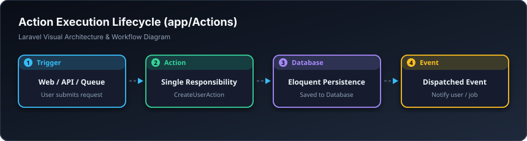

# ⚡ کرداری تاکە ئەرک — Actions (`app/Actions`)

> **ئاستی پێویست:** ئاستی پێشکەوتوو (Senior Developer)  
> **ئامانجی سەرەکی:** جێبەجێکردنی بنەمای Single Responsibility Principle (تەنها یەک ئیش بۆ هەر کڵاسێک)

---

## 🖼️ وێنەی ڕێڕەوی کارکردن (Visual Workflow)




## 📌 ئەکشن (Action) بە کوردییەکی زۆر سادە چییە؟

ئەکشن واتە: **یەک کڵاس کە تەنها و تەنها یەک ئیشی دیاریکراو لە تەواوی سیستمەکەدا جێبەجێ دەکات.**

💡 **نموونەی ژیانی ڕۆژانە بۆ فێرخوازان:**  
لە چێشتخانەیەکی گەورەدا، کەسێک هەیە تەنها کاری ئەوەیە «پیتزا ببڕێت». ئەو کەسە نە پارە لە کڕیار وەردەگرێت، نە قاپ دەشوات، نە پێشوازی لە خەڵک دەکات؛ تەنها پیتزا دەبڕێت!  
لە پڕۆژەی لارافێڵیشدا، کڵاسی `CreateUserAction` تەنها کاری ئەوەیە «بەکارهێنەری نوێ دروست بکات». گرنگ نییە ئەو بەکارهێنەرە لە ڕێگەی وێبگەڕەوە خۆی تۆمار دەکات، یان ئەپڵیکەیشنی مۆبایل، یان بە فەرمانی تێرمیناڵ؛ هەموویان یەک کڵاس بانگ دەکەن.

---

## 🛑 پێش ئەوەی ئەکشن بەکاربهێنین کێشە چی بوو؟

کێشەی زۆربەی پرۆگرامەرە سەرەتاییەکان ئەوەیە کۆدی دروستکردنی بەکارهێنەر لە ناو `RegisterController` دەنووسن.  
سبەی ئەگەر ویستیان لە ڕێگەی API مۆبایل، یان لە ناو ئەرکێکی پاشبنەما (Job)، یان لە تێرمیناڵ بەکارهێنەر دروست بکەن، ناچار دەبن هەمان کۆد کۆپی بکەنەوە! بەڵام بە بوونی **Action** کۆدەکە لە یەک شوێندایە و سەدان جار بەکاری دەهێنیتەوە.

---

## 🔄 نەخشەی کارکردنی ئەکشن (Workflow Diagram)

```text
[ وێبگەڕ (Web Form) ] ──┐
                         │
[ ئەپی مۆبایل (API)  ] ──┼──► [ CreateUserAction ] ──► [ بنکەدراوە / Database ]
                         │            │
[ تێرمیناڵ (Artisan) ] ──┘            └──► [ ناردنی ئیمەیڵی بەخێرهاتن ]
```

---

## 💻 نموونەی کۆدی کردارەکە (`CreateUserAction.php`)

```php
namespace App\Actions;

use App\Models\User;
use Illuminate\Support\Facades\Hash;

class CreateUserAction
{
    /**
     * جێبەجێکردنی دروستکردنی بەکارهێنەر
     */
    public function execute(array $data): User
    {
        // ١. دروستکردنی بەکارهێنەر لە داتابەیس
        $user = User::create([
            'name'     => $data['name'],
            'email'    => $data['email'],
            'password' => Hash::make($data['password']),
        ]);

        // ٢. لێرە دەتوانیت ڕووداو (Event) بنێریت بۆ ئیمەیڵی بەخێرهاتن
        // event(new UserRegisteredEvent($user));

        return $user;
    }
}
```

---

## 🚀 چۆن لە کۆنتڕۆڵەردا بانگی بکەین؟

سەیر بکە کۆنتڕۆڵەر چەندە پاک و کورت دەبێتەوە:

```php
namespace App\Http\Controllers;

use App\Actions\CreateUserAction;
use App\Http\Requests\RegisterRequest;
use Illuminate\Http\RedirectResponse;

class RegisterController extends Controller
{
    public function store(RegisterRequest $request, CreateUserAction $createUser): RedirectResponse
    {
        // هەموو لۆجیکەکە تەنها لەم دێڕەدا جێبەجێ دەبێت:
        $user = $createUser->execute($request->validated());

        auth()->login($user);

        return redirect()->route('dashboard');
    }
}
```

---

## ⚖️ کەی بەکاری بهێنین و کەی نا؟

| کەی بەکاری بهێنین؟ (Do's) | کەی بەکاری نەهێنین؟ (Don'ts) |
| :--- | :--- |
| کاتێک کردارەکە لە چەندین شوێنی جیاواز دووبارە دەبێتەوە | بۆ کرداری زۆر زۆر بچووک وەک تەنها هێنانی یەک دێڕ لە داتابەیس |
| کاتێک پرۆسەکە هەنگاوی زۆری تێدایە (سەیڤکردن + ئیمەیڵ + لۆگ) | کاتێک پرۆژەکەت زۆر زۆر سادەیە و هەر تەنها یەک لاپەڕەیە |

---

## 🎓 سەرچاوە فێرکارییە تایبەتەکان بۆ ئەم بابەتە (Courses & Tutorials)

* 🎥 **Laracasts (تایبەت بە دیزاینی ئەکشن):**  
  [Laracasts: Managing Business Logic with Actions](https://laracasts.com/series/laravel-beyond-crud/episodes/2)
* 📺 **فێرکاری ڤیدیۆیی یوتیوب (Free Course):**  
  [YouTube: How to use Actions in Laravel like a PRO (Brent - Spatie)](https://www.youtube.com/results?search_query=laravel+actions+pattern)
* 📖 **ڕێبەری نووسراوی Spatie:**  
  [Laravel Beyond CRUD - Actions](https://stitcher.io/blog/laravel-beyond-crud-02-actions)
