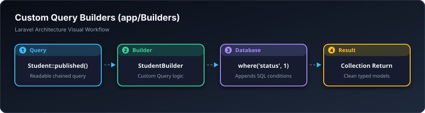

# 🔨 کوێری بیڵدەری تایبەت — Query Builders (`app/Builders`)

> **ئاستی پێویست:** ئاستی پێشکەوتوو (Senior Developer)  
> **ئامانجی سەرەکی:** جیاکردنەوەی کوێرییە ئاڵۆزەکانی داتابەیس لە ناو مۆدێل بۆ ئەوەی مۆدێلەکان شێواو و قورس نەبن.

---

## 🖼️ وێنەی ڕێڕەوی کارکردن (Visual Workflow)

---

## 📌 بیڵدەر بە کوردییەکی سادە چییە؟

لە پڕۆژەی گەورەدا، ئەگەر کوێرییەکانی وەک:  
`Student::where('is_active', true)->whereHas('courses')->whereYear('created_at', 2026)->get()`  
لە هەموو شوێنێک بنووسیتەوە یان بکەیتە ناو Scopeـی مۆدێلەکە، پاش ماوەیەک مۆدێلەکەت دەبێتە هەزار دێڕ!  
بیڵدەر کڵاسێکی سەربەخۆیە تەنها بۆ ڕێکخستنی کوێرییەکانی ئەو مۆدێلە بە شێوازێکی زۆر پاک و ڕوون:  
`Student::query()->active()->enrolledInCourses()->get();`

---

## 🎓 سەرچاوەی فێربوون
* 🎥 [Laracasts: Dedicated Query Builders](https://laracasts.com)
