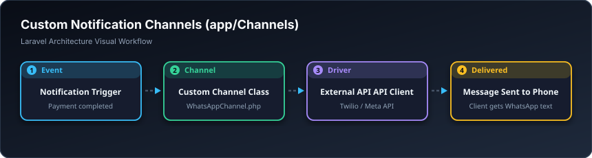

# 📡 کەناڵە تایبەتەکان — Channels (`app/Channels`)

> **ئاستی پێویست:** ئاستی پێشکەوتوو (Senior Developer)  
> **ئامانجی سەرەکی:** دروستکردنی کەناڵی نوێ بۆ ناردنی ئاگادارییەکان لە دەرەوەی ئیمەیڵ (وەک: ناردنی نامە لە ڕێگەی واتسئاپ، تێلێگرام، یان ڤایبەر).

---

## 🖼️ وێنەی ڕێڕەوی کارکردن (Visual Workflow)

---

## 📌 کەناڵ بە کوردی چییە؟

کاتێک تۆ سیستەمێکی ئاگاداری دروست دەکەیت، ڕەنگە نەوتەوێت تەنها ئیمەیڵ بنێریت؛ بەڵکو دەتەوێت کاتێک قوتابییەک کۆرسێک دەکڕێت، نامەیەکی فەرمی بە **واتسئاپ (WhatsApp)** بۆ مۆبایلەکەی بڕوات.  
لە ناو ئەم فۆڵدەرە کڵاسی کەناڵی تایبەت وەک `WhatsAppChannel` دروست دەکەیت کە پەیوەندی بە API واتسئاپ دەکات و نامەکە دەگەیەنێت.

---

## 🎓 سەرچاوەی فێربوون
* 📖 [Laravel Docs: Custom Notification Channels](https://laravel.com/docs/notifications#custom-channels)
