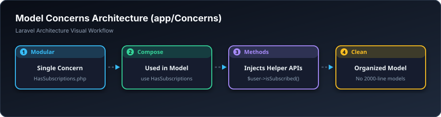

# 🧬 کەرەستە هاوبەشەکان — Concerns (`app/Concerns`)

> **ئاستی پێویست:** ئاستی پێشکەوتوو (Senior Developer)  
> **ئامانجی سەرەکی:** ڕێکخستنی تواناکانی مۆدێل بە شێوازی پارچەپارچە و مۆدیولار تا مۆدێل درێژ و شێواو نەبێت.

---

## 🖼️ وێنەی ڕێڕەوی کارکردن (Visual Workflow)

---

## 📌 کۆنسێرن بە کوردی چییە؟

کۆنسێرن (Concerns) ناوی ستاندارد و ئەدەبییە بۆ **Traits** لە ناو پڕۆژە زەبەلاحەکاندا. کاتێک مۆدێلی `User` چەندین توانای هەیە (وەک: بەشداری مانگانە، نمرەی خوێندکار، مێژووی چوونەژوورەوە)، لە بری ئەوەی هەموو فانکشنەکان لە ناو فایلی `User.php` کۆبکەیتەوە، دەیکەیتە چەندین پارچەی بچووک لەم فۆڵدەرەدا وەک `HasSubscriptions`, `HasGrades`.

---

## 🎓 سەرچاوەی فێربوون
* 📖 [Laravel Framework Concerns Source Code](https://github.com/laravel/framework/tree/master/src/Illuminate/Database/Eloquent/Concerns)
