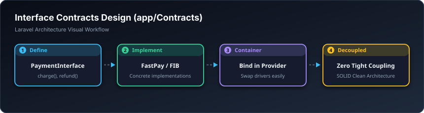

# 📋 پەیماننامە و نەخشەکان — Contracts & Interfaces (`app/Contracts`)

> **ئاستی پێویست:** ئاستی پێشکەوتوو (Senior Developer - هەنگاوی ٢١)  
> **ئامانجی سەرەکی:** جێبەجێکردنی بنەماکانی SOLID و تەلارسازی دابڕاو (Loose Coupling).

---

## 🖼️ وێنەی ڕێڕەوی کارکردن (Visual Workflow)

---

## 📌 کۆنتراکت بە کوردی چییە؟

کۆنتراکت بریتییە لە نەخشەی خانوو پێش دروستکردنی! نەخشەکە پێت دەڵێت چەند ژوور و دەرگای هەیە بەڵام خۆی بلۆک و چیمەنتۆ نییە.  
لە پڕۆژەی لارافێڵدا، ئینتەرفەیسێک دروست دەکەیت تا کڵاسەکان ناچار بکات بە یەک یاسا کار بکەن، و ئەمەش وا دەکات گۆڕینی خزمەتگوزارییەکان لە داهاتوودا تەنها یەک خولەکی بوێت.

---

## 🎓 سەرچاوەی فێربوون
* 🎥 [Laracasts: SOLID Principles in PHP](https://laracasts.com/series/solid-principles-in-php)
