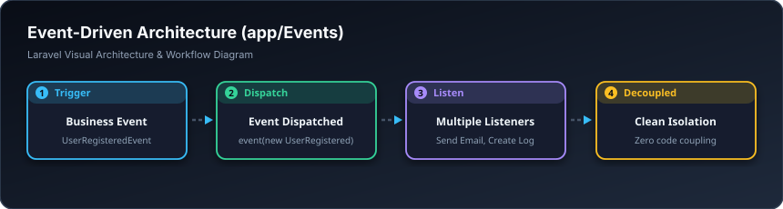

# 📢 ڕووداوەکان — Events (`app/Events`)

> **ئاستی پێویست:** ئاستی پێشکەوتوو (Senior Developer - هەنگاوی ١٩)  
> **ئامانجی سەرەکی:** دابڕینی کۆدەکان لە یەکتر بە بەکارهێنانی تەلارسازی کارکردن بەپێی ڕووداو (Event-Driven Architecture).

---

## 🖼️ وێنەی ڕێڕەوی کارکردن (Visual Workflow)




## 📌 ڕووداو (Event) بە کوردییەکی سادە چییە؟

ڕووداو وەکو **ئاگری زەنگی ئاگادارکردنەوە** وایە!  
کاتێک ئاگرەکە دەکەوێتەوە (بۆ نموونە قوتابییەک کۆرسێک دەکڕێت)، Event تەنها کاری ئەوەیە بڵێت: **«ئاگادارببن، قوتابی ئازاد فڵانە کۆرسی کڕی!»**.  
خودی Event هیچ کارێکی تر ناکات؛ بەڵکو کڵاسەکانی **Listeners** بەم دەنگە هەڵدەستن و کارەکان دەکەن:
1. گوێگری یەکەم پسوڵە دەنێرێت.
2. گوێگری دووەم ئاگاداری بۆ مامۆستاکە دەنێرێت.
3. گوێگری سێیەم ناوی قوتابی دەخاتە گروپی تێلێگرامەوە.

ئەم تەلارسازییە وا دەکات هەر کاتێک ویستت کارێکی نوێ زیاد بکەیت، هەرگیز دەستکاری کۆدی کڕینەکە نەکەیت، تەنها یەک گوێگر (Listener) لە پەناوە زیاد دەکەیت.

---

## 💻 نموونەی کۆد (`CoursePurchasedEvent.php`)

```php
namespace App\Events;

use App\Models\Course;
use App\Models\User;
use Illuminate\Foundation\Events\Dispatchable;
use Illuminate\Queue\SerializesModels;

class CoursePurchasedEvent
{
    use Dispatchable, SerializesModels;

    public function __construct(
        public User $student,
        public Course $course
    ) {}
}
```

---

## 🎓 سەرچاوە فێرکارییە تایبەتەکان بۆ ئەم بابەتە

* 🎥 **Laracasts (کۆرسی ناسینی تەواوی ڕووداوەکان):**  
  [Laracasts: Events and Listeners in Depth](https://laracasts.com/series/laravel-30-days-to-learn-it/episodes/20)
* 📺 **فێرکاری ڤیدیۆیی یوتیوب:**  
  [YouTube: Laravel Events and Listeners Explained Simply](https://www.youtube.com/results?search_query=laravel+events+and+listeners+tutorial)
