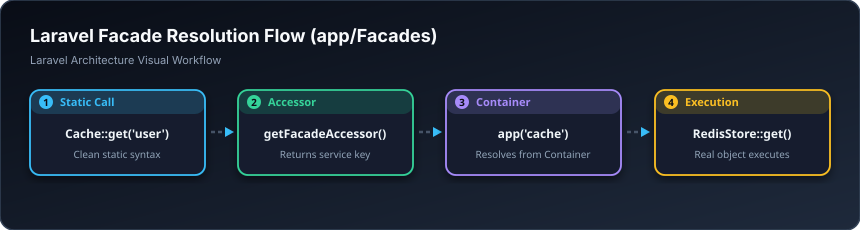

# 🎭 فاسادەکان — Facades (`app/Facades`)

> **ئاستی پێویست:** ئاستی پێشکەوتوو (Senior Developer)  
> **ئامانجی سەرەکی:** دروستکردنی شێوازی بانگکردنی کورت و Static بۆ ئەو کڵاسانەی لە ناو Service Container دان.

---

## 🖼️ وێنەی ڕێڕەوی کارکردن (Visual Workflow)


---

## 📌 فاساد (Facade) بە کوردییەکی زۆر سادە چییە؟

فاساد وەک **کۆنتڕۆڵی تەلەڤزیۆن** وایە!  
تۆ کاتێک دوگمەی داگیرساندن دادەگریت، ناچیتە ناو وایەرەکان و بۆردی کارەبای ناوەوە؛ تەنها بە یەک پەنجە کارەکە دەکەیت.  
لە لارافێڵدا، لە بری ئەوەی بنووسیت:  
`app()->make('App\Services\SmsService')->send('0750...', 'سڵاو')`  
کڵاسێکی Facade دروست دەکەیت تا ڕێک وەک فانکشنی Static بنووسیت:  
`Sms::send('0750...', 'سڵاو')`

فاساد وادەکات کۆدەکانت زۆر جوان، کورت، و خوێنەرەوە بن بەبێ ئەوەی دەستبەرداری سوودەکانی Dependency Injection ببیت.

---

## 💻 نموونەی کۆد (`Sms.php`)

```php
namespace App\Facades;

use Illuminate\Support\Facades\Facade;

class Sms extends Facade
{
    /**
     * ناوی ئەو کڵاسەی کە لە ناو Service Container تۆمار کراوە
     */
    protected static function getFacadeAccessor(): string
    {
        return 'sms.service';
    }
}
```

---

## 🎓 سەرچاوەی فێربوون
* 📖 [Laravel Docs: Facades](https://laravel.com/docs/facades)
* 🎥 [Laracasts: How Facades Work Under The Hood](https://laracasts.com/series/how-to-read-code/episodes/2)
