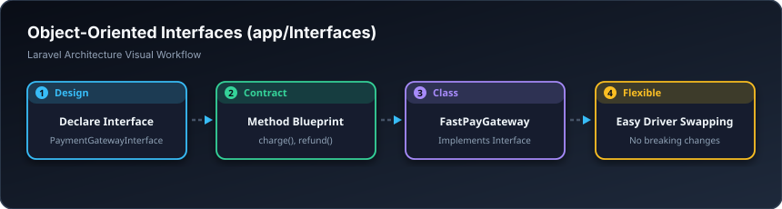

# 📋 نەخشە و ئینتەرفەیسەکان — Interfaces (`app/Interfaces`)

> **ئاستی پێویست:** ئاستی پێشکەوتوو (Senior Developer)  
> **ئامانجی سەرەکی:** نەخشەسازی و داڕشتنی گرێبەستی کڵاسەکان بۆ جێبەجێکردنی بنەماکانی SOLID.

---

## 🖼️ وێنەی ڕێڕەوی کارکردن (Visual Workflow)

---

## 📌 ئینتەرفەیس بە کوردی چییە؟

ئینتەرفەیس وەکو **نەخشەی ئەندازیاری خانوو** وایە!  
نەخشەکە پێت دەڵێت هەر کڵاسێک هاتە ناو سیستەم دەبێت کام فانکشنانەی هەبێت. بەم شێوازە لە داهاتوودا دەتوانیت بە یەک چرکە کڵاسی پارەدان لە بانکێکەوە بۆ بانکێکی تر بگۆڕیت بەبێ ئەوەی یەک دێڕی ماڵپەڕەکەت تێکبچێت.
