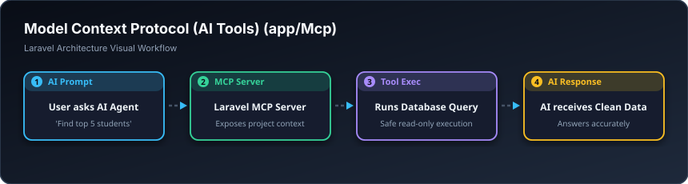

# 🤖 ئامرازەکانی ژیری دەستکرد — Model Context Protocol (`app/Mcp`)

> **ئاستی پێویست:** ئاستی مۆدێرن و باڵا (Laravel 11+ / AI Ecosystem)  
> **ئامانجی سەرەکی:** دروستکردنی کەرەستە و ئامراز بۆ ئەوەی یاریدەدەری ژیری دەستکرد (AI Agents) بتوانێت لە پڕۆژەکەت تێبگات و یارمەتیت بدات.

---

## 🖼️ وێنەی ڕێڕەوی کارکردن (Visual Workflow)

---

## 📌 ئەی ئای ئێم سی پی بە کوردی چییە؟

ئەم فۆڵدەرە لە نوێترین ڤێرژنەکانی لارافێڵدا دروستکراوە؛ ڕێگە دەدات ئامراز (Tools) و پرۆمپت (Prompts) بۆ مۆدێلەکانی AI دروست بکەیت تا بریکارە زیرەکەکان (وەک Claude, ChatGPT, Antigravity) بتوانن بە پارێزراوی داتای پڕۆژەکەت بخوێننەوە و یارمەتیت بدەن لە چارەسەرکردنی کێشەکاندا.

---

## 🎓 سەرچاوەی فێربوون
* 📖 [Laravel MCP Documentation](https://github.com/laravel/mcp)
