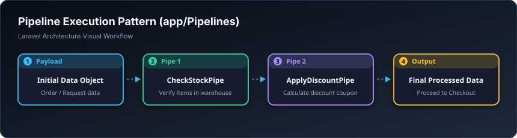

# 🚰 بۆرییەکانی جێبەجێکردن — Pipelines (`app/Pipelines`)

> **ئاستی پێویست:** ئاستی پێشکەوتوو (Senior Developer)  
> **ئامانجی سەرەکی:** تێپەڕاندنی داتایەک بە ناو زنجیرەیەک قۆناغی یەک لە دوای یەک (وەک هێڵی بەرهەمهێنانی کارگە).

---

## 🖼️ وێنەی ڕێڕەوی کارکردن (Visual Workflow)

---

## 📌 پایپلاین بە کوردی چییە؟

پایپلاین وەکو **هێڵی پشکنینی ئۆتۆمبێل (هەزە)** وایە!  
ئۆتۆمبێلەکە لە چەند وێستگەیەک تێدەپەڕێت:
1. وێستگەی یەکەم: پشکنینی برێک.
2. وێستگەی دووەم: پشکنینی تیشکی لایتەکان.
3. وێستگەی سێیەم: پشکنینی گزۆز و دووکەڵ.

ئەگەر لە هەموویان دەربچێت، ئەنجامەکەی پێ دەدرێت. لە لارافێڵدا، بۆ کارەکانی وەک فلتەرکردنی بەرهەمەکان (سێرچی پێشکەوتوو بەپێی نرخ، ڕەنگ، قەبارە، مارکە) یان پرۆسەی کڕین، Pipeline باشترین شێوازی تەلارسازییە.

---

## 🎓 سەرچاوەی فێربوون
* 🎥 [Laracasts: The Pipeline Pattern Explained](https://laracasts.com)
