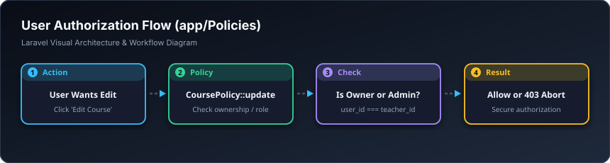

# 👮 سیاسەتی دەسەڵات — Policies (`app/Policies`)

> **ئاستی پێویست:** ئاستی پێشکەوتوو (Senior Developer - هەنگاوی ٢٠)  
> **ئامانجی سەرەکی:** کۆنتڕۆڵکردنی ئاستی دەسەڵات (Authorization) و پاراستنی داتا لە دەستکاری نەشیاو.

---

## 🖼️ وێنەی ڕێڕەوی کارکردن (Visual Workflow)




## 📌 پۆلیسی (Policy) بە کوردییەکی سادە چییە؟

پۆلیسی وەڵامی ئەم پرسیارە دەداتەوە: **«ئایا ئەم بەکارهێنەرە مافی هەیە دەستکاری ئەم شتە بکات یان نا؟»**

جیاوازی نێوان چوونەژوورەوە (Authentication) و دەسەڵات (Authorization):
* **Authentication (چوونەژوورەوە):** دڵنیادەبێتەوە لەوەی تۆ بەکارهێنەری ئەم ماڵپەڕەیت (تۆ ئازادی).
* **Authorization (دەسەڵات - Policy):** دڵنیادەبێتەوە ئایا تۆ مافی ئەوەت هەیە پۆستەکەی مامۆستا ڕێبوار بسڕیتەوە؟ نەخێر، چونکە تۆ دروستکەری ئەو پۆستە نیت!

---

## 💻 نموونەی کۆد (`CoursePolicy.php`)

```php
namespace App\Policies;

use App\Models\Course;
use App\Models\User;

class CoursePolicy
{
    /**
     * ئایا ئەم مامۆستایە دەتوانێت دەستکاری کۆرسەکە بکات؟
     */
    public function update(User $user, Course $course): bool
    {
        // تەنها لەم دوو حاڵەتەدا ڕێگەی پێدەدرێت:
        // ١. ئەگەر بەڕێوەبەری گشتی بێت (Admin)
        // ٢. یان ئەگەر خۆی مامۆستای دروستکەری کۆرسەکە بێت
        return $user->is_admin || $user->id === $course->teacher_id;
    }

    /**
     * ئایا مافی سڕینەوەی هەیە؟
     */
    public function delete(User $user, Course $course): bool
    {
        return $user->is_admin;
    }
}
```

---

## 🚀 چۆن لە کۆنتڕۆڵەر یان پەڕەی Blade بەکاری بهێنین؟

لە ناو کۆنتڕۆڵەر:
```php
public function edit(Course $course)
{
    $this->authorize('update', $course); // ئەگەر مافی نەبێت دەستبەجێ هەڵەی 403 دەدات

    return view('courses.edit', compact('course'));
}
```

لە ناو پەڕەی Blade (HTML):
```blade
@can('update', $course)
    <a href="{{ route('courses.edit', $course) }}">دەستکاری کۆرس</a>
@endcan
```

---

## 🎓 سەرچاوە فێرکارییە تایبەتەکان بۆ ئەم بابەتە

* 🎥 **Laracasts (کۆرسی تەواوی دەسەڵات و مۆڵەتەکان):**  
  [Laracasts: Authorization with Policies in Laravel](https://laracasts.com/series/laravel-30-days-to-learn-it)
* 📺 **فێرکاری ڤیدیۆیی یوتیوب:**  
  [YouTube: Laravel Policies and Gates Full Guide](https://www.youtube.com/results?search_query=laravel+policies+tutorial)
* 📖 **بەڵگەنامەی فەرمی لارافێڵ:**  
  [Laravel Docs: Authorization](https://laravel.com/docs/authorization)
