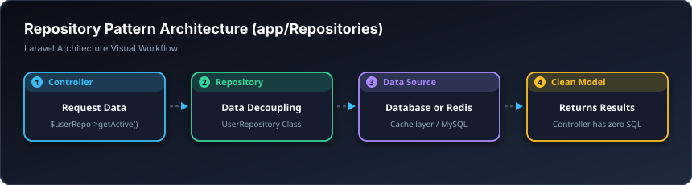

# 🏛️ کۆگای داتا — Repositories (`app/Repositories`)

> **ئاستی پێویست:** ئاستی پێشکەوتوو (Senior Developer - هەنگاوی ٢٢)  
> **ئامانجی سەرەکی:** دابڕینی تەواوی فەرمانەکانی بنکەدراوە لە کۆنتڕۆڵەرەکان.

---

## 🖼️ وێنەی ڕێڕەوی کارکردن (Visual Workflow)

---

## 📌 ڕیپۆزیتۆری بە کوردی چییە؟

ڕیپۆزیتۆری وەک عەمباردار وایە لە نێوان تۆ و کاڵاکاندا؛ تۆ پێی دەڵێیت «دە قوتابییە یەکەمەکانم بۆ بهێنە»، ئیتر ئەو بە دڵی خۆی بڕیار دەدات لە ناو داتابەیس بیهێنێت یان لە ناو کاش، کۆنتڕۆڵەرەکە کاتی بەم جیاوازییانەوە ناڕوات.

---

## 🎓 سەرچاوەی فێربوون
* 🎥 [Laracasts: Repository Pattern Simplified](https://laracasts.com)
