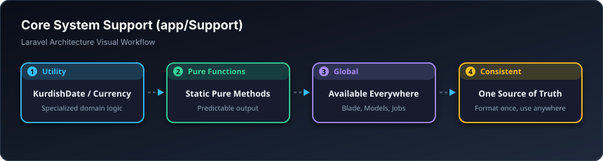

# 🛠️ کەرەستە و یارمەتیدەرەکان — Support (`app/Support`)

> **ئاستی پێویست:** ئاستی ناوەند بۆ پێشکەوتوو (Mid to Senior)  
> **ئامانجی سەرەکی:** کڵاسە یارمەتیدەرەکانی وەک ڕێکخستنی بەرواری کوردی، گۆڕینی پارە، و ژمێریاری.

---

## 🖼️ وێنەی ڕێڕەوی کارکردن (Visual Workflow)

---

## 📌 سەپۆرت بە کوردی چییە؟

شوێنی ئەو کڵاس و کەرەستە تایبەتانەیە کە سیستەمەکە پێویستی پێیەتی لە چەندین بەشی جیاوازدا؛ وەک کڵاسی گۆڕینی ژمارە بۆ پیتی کوردی یان پشکنینی ڕاستی ساڵنامەی کۆچی.
