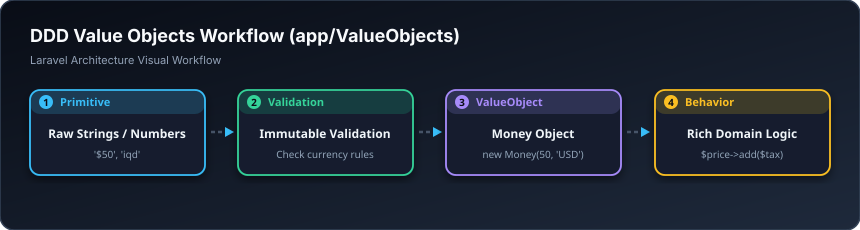

# 💎 ئۆبجێکتی بەها — Value Objects (`app/ValueObjects`)

> **ئاستی پێویست:** ئاستی پێشکەوتوو (Senior Developer)  
> **ئامانجی سەرەکی:** جێگرتنەوەی داتا سەرەتاییەکان (وەک تێکست و ژمارەی سادە) بە ئۆبجێکتی پارێزراو کە خاوەنی لۆجیکی خۆیانن.

---

## 🖼️ وێنەی ڕێڕەوی کارکردن (Visual Workflow)

---

## 📌 ڤالیو ئۆبجێکت بە کوردی چییە؟

لە بری ئەوەی ژمارەی مۆبایل وەک دەقێکی ئاسایی `$user->phone = "07501234567"` هەڵبگریت کە هیچ ژیرییەکی تێدا نییە؛ کڵاسێکی `PhoneNumber` دروست دەکەیت کە:
* ڕێگری لە ژمارەی هەڵە دەکات.
* شێوازی کورت یان نێودەوڵەتی بە شێوەی ئۆتۆماتیک دەگەڕێنێتەوە (`$phone->toInternational()`).
* دڵنیایی دەدات بەهای ناوەکەی هەرگیز ناتوانرێت بشێوێنرێت (Immutable).

---

## 🎓 سەرچاوەی فێربوون
* 📖 [Value Objects in Domain-Driven Design (PHP)](https://stitcher.io)
