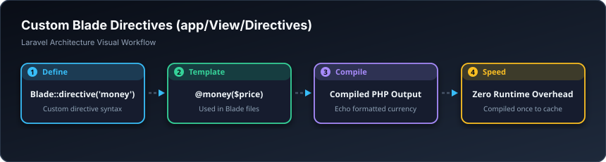

# 🪄 فەرمانە تایبەتەکانی بلەید — Directives (`app/View/Directives`)

> **ئاستی پێویست:** ئاستی پێشکەوتوو (Senior Developer)  
> **ئامانجی سەرەکی:** دروستکردنی فەرمانی نوێی تایبەت لە ناو پەڕەکانی Blade وەک `@money($price)` یان `@kurdish_date($date)`.

---

## 🖼️ وێنەی ڕێڕەوی کارکردن (Visual Workflow)

---

## 📌 دایرێکتیڤ بە کوردی چییە؟

لە بری ئەوەی لە هەموو لاپەڕەیەکدا کۆدی قورسی گۆڕینی نرخ بۆ دیناری عێراقی بنووسیت، فەرمانێکی بچووک دروست دەکەیت تا ڕێک بنووسیت:  
`@money(25000)` و ئەویش لە شاشەدا دەیکاتە: `25,000 د.ع`.
