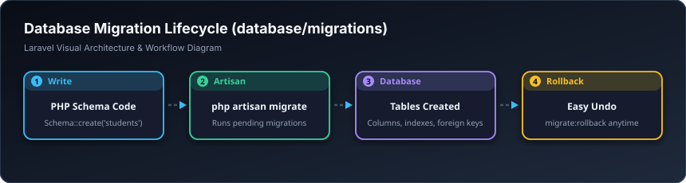

# 🏗️ مایگرەیشن — Migrations (`database/migrations`)

> **ئاستی پێویست:** ئاستی سەرەتایی (Junior Developer - هەنگاوی ٤)  
> **ئامانجی سەرەکی:** نەخشەسازی و دروستکردنی خشتەکانی بنکەدراوە بە کۆدی PHP لە بری دەستکاری دەستی.

---

## 🖼️ وێنەی ڕێڕەوی کارکردن (Visual Workflow)




## 📌 مایگرەیشن بە کوردییەکی سادە چییە؟

مایگرەیشن وەک **سیستەمی Git وایە بۆ بنکەدراوەکەت (Version Control for Database)!**  
پێشتر کاتێک تیمێک پێکەوە کاریان دەکرد، ئەگەر بەرنامەسازێک ستوونێکی نوێی زیاد بکردایە لە خشتەیەکدا، دەبوو فایلی SQL بۆ هاوڕێکەی بنێرێت تا ئەویش دەستی لێبدات؛ کە زۆرجار کێشەی گەورەی دروست دەکرد.

لەگەڵ مایگرەیشن:
* هەموو خشتە و ستوونەکان بە کۆدی پوختی PHP دەنووسرێن.
* هەر هاوڕێیەکی تیمەکە پڕۆژەکە داببەزێنێت، تەنها بە فەرمانی `php artisan migrate` لە چەند چرکەیەکدا هەموو خشتەکانی بۆ دروست دەبێت!
* دەتوانیت لە هەر کاتێکدا بگەڕێیتەوە بۆ دواوە (Rollback).

---

## 💻 نموونەی کۆد (`create_courses_table.php`)

```php
use Illuminate\Database\Migrations\Migration;
use Illuminate\Database\Schema\Blueprint;
use Illuminate\Support\Facades\Schema;

return new class extends Migration
{
    public function up(): void
    {
        Schema::create('courses', function (Blueprint $table) {
            $table->id();
            $table->foreignId('teacher_id')->constrained('users')->cascadeOnDelete();
            $table->string('title');
            $table->text('description')->nullable();
            $table->decimal('price', 8, 2)->default(0);
            $table->boolean('is_published')->default(false);
            $table->timestamps(); // ستوونی created_at و updated_at
        });
    }

    public function down(): void
    {
        Schema::dropIfExists('courses');
    }
};
```

---

## 🛠️ فەرمانە بەسوودەکانی مایگرەیشن لە تێرمیناڵ:

```bash
# دروستکردنی مایگرەیشنی نوێ
php artisan make:migration create_courses_table

# جێبەجێکردنی خشتە نوێیەکان لە داتابەیس
php artisan migrate

# سڕینەوە و دروستکردنەوەی هەموو خشتەکان لە سفرەوە (Fresh)
php artisan migrate:fresh
```

---

## 🎓 سەرچاوە فێرکارییە تایبەتەکان بۆ ئەم بابەتە

* 🎥 **Laracasts (فێرکاری وردی مایگرەیشن):**  
  [Laracasts: Database Migrations from Scratch](https://laracasts.com/series/laravel-30-days-to-learn-it/episodes/9)
* 📺 **فێرکاری ڤیدیۆیی یوتیوب:**  
  [YouTube: Laravel Migrations Everything You Need to Know](https://www.youtube.com/results?search_query=laravel+database+migrations+tutorial)
* 📖 **بەڵگەنامەی فەرمی لارافێڵ:**  
  [Laravel Docs: Migrations](https://laravel.com/docs/migrations)
