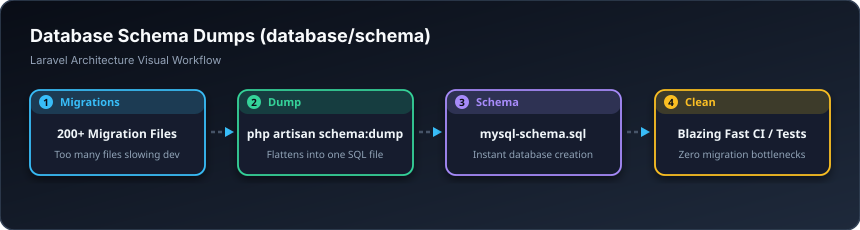

# 🏛️ وێنەی بنکەدراوە — Schema (`database/schema`)

> **ئاستی پێویست:** ئاستی پێشکەوتوو (Senior Developer)  
> **ئامانجی سەرەکی:** یەکخستنی سەدان فایلی مایگرەیشن لە ناو یەک فایلی خێرای SQL کاتێک پڕۆژەکە زۆر گەورە دەبێت.

---

## 🖼️ وێنەی ڕێڕەوی کارکردن (Visual Workflow)

---

## 📌 سکێما دەمپ بە کوردی چییە؟

کاتێک پڕۆژەکە دەبێتە ٥ ساڵە و زیاتر لە ٢٠٠ فایلی مایگرەیشنی تێدا دروست دەبێت، ڕاکردنی `migrate:fresh` خولەکی زۆری دەوێت. بە فەرمانی `php artisan schema:dump` لارافێڵ هەمووی دەپەستێوێتە ناو یەک فایلی SQL لەم فۆڵدەرەدا بۆ دروستکردن لە کەمتر لە یەک چرکەدا.
