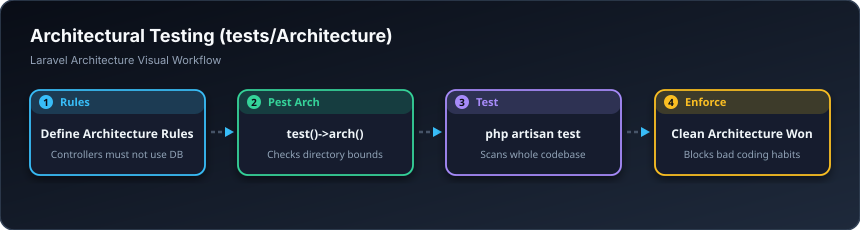

# 🏛️ تاقیکردنەوەی تەلارسازی — Architecture Tests (`tests/Architecture`)

> **ئاستی پێویست:** ئاستی پێشکەوتوو (Senior Developer)  
> **ئامانجی سەرەکی:** سەپاندنی یاسای توند لەسەر پڕۆگرامەران کە نابێت کۆدی پیس بنووسن (وەک: قەدەغەکردنی بەکارهێنانی `die()` یان پەیوەندی ڕاستەوخۆ بە داتابەیس لە کۆنتڕۆڵەردا).

---

## 🖼️ وێنەی ڕێڕەوی کارکردن (Visual Workflow)

---

## 📌 تاقیکردنەوەی تەلارسازی بە کوردی چییە؟

ئەم تاقیکردنەوەیە پشکنین بۆ دروستی ئەپڵیکەیشنەکە ناکات؛ بەڵکو پشکنین بۆ **کوالێتی کۆدی پڕۆگرامەرەکە** دەکات! بۆ نموونە یاسا دادەنێیت: «هەموو مۆدێلەکان دەبێت لە فۆڵدەری Models بن»، ئەگەر کەسێک لە شوێنێکی تر دایبنێت، ڕێگەی پێ نادات کۆدەکە بنێرێتە سەر گیت‌هەب!
