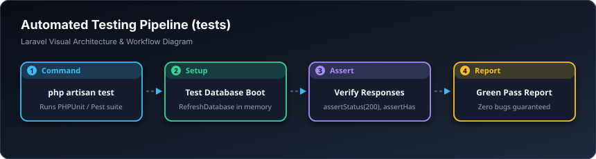

# 🧪 تاقیکردنەوەی خۆکار — Automated Testing (`tests`)

> **ئاستی پێویست:** لە ئاستی ناوەندەوە بۆ پێشکەوتوو (Mid-Level to Senior - هەنگاوی ١٣)  
> **ئامانجی سەرەکی:** پاراستنی پرۆژەکە لە شکانی نەخوازراو لە کاتی گۆڕانکاری و کۆدنووسیندا.

---

## 🖼️ وێنەی ڕێڕەوی کارکردن (Visual Workflow)




## 📌 تاقیکردنەوە (Testing) بە کوردییەکی سادە چییە؟

تاقیکردنەوە واتە: **نووسینی کۆدێک کە پشکنین بۆ کۆدەکانی ترت بکات!**  
پڕۆگرامەری سەرەتایی هەموو جارێک بۆ پشکنینی فۆڕمێک، وێبگەڕ دەکاتەوە و بە دەست داتاکان پڕ دەکاتەوە. ئەگەر پڕۆژەکەت ١٠٠ لاپەڕە بێت مەحاڵە بە دەست هەمووی بپشکنیت!  
بەڵام کاتێک تاقیکردنەوە دەنوسیت، تەنها بە لێدانی فەرمانی `php artisan test`، سیستەمەکە لە ماوەی **٢ چرکەدا** وەک مرۆڤێک دەچێتە ناو وێب، خۆی تۆمار دەکات، پارە دەدات، سەیری داتابەیس دەکات و ئەنجامەکەت پێ دەڵێت!

---

## 📂 جۆرەکانی تاقیکردنەوە:
1. **`Unit/`:** پشکنینی یەک فەنکشنی بیرکاری یان یەک کڵاسی بچووک بە تەنیایی.
2. **`Feature/`:** پشکنینی پڕۆسەی تەواوی وێب (ناردنی فۆڕمی ناونووسین و دڵنیابوونەوە لەوەی تۆمار بوو).

---

## 💻 نموونەی تاقیکردنەوەی فیچەر (`StudentRegistrationTest.php`)

```php
namespace Tests\Feature;

use Illuminate\Foundation\Testing\RefreshDatabase;
use Tests\TestCase;

class StudentRegistrationTest extends TestCase
{
    use RefreshDatabase; // بۆ خاوێنکردنەوەی داتابەیس پاش هەر تاقیکردنەوەیەک

    public function test_student_can_register_successfully(): void
    {
        // ١. بەکارهێنەر داواکاری دەنێرێت بۆ خۆتۆمارکردن
        $response = $this->post('/register', [
            'name'                  => 'ئازاد محەمەد',
            'email'                 => 'azad@example.com',
            'password'              => 'password123',
            'password_confirmation' => 'password123',
        ]);

        // ٢. وەڵامەکە سەرکەوتووە و دەیباتە سەر داشبۆرد
        $response->assertRedirect('/dashboard');

        // ٣. دڵنیابوونەوە لەوەی قوتابییەکە لە داتابەیس تۆمار بووە
        $this->assertDatabaseHas('users', [
            'email' => 'azad@example.com',
        ]);
    }
}
```

---

## 🛠️ فەرمانی ڕاکردنی تاقیکردنەوەکان:

```bash
php artisan test
```

---

## 🎓 سەرچاوە فێرکارییە تایبەتەکان بۆ ئەم بابەتە

* 🎥 **Laracasts (کۆرسی مەزنی تاقیکردنەوە):**  
  [Laracasts: Testing Laravel from Scratch (PHPUnit & Pest)](https://laracasts.com/series/phpunit-testing-in-laravel)
* 📺 **فێرکاری ڤیدیۆیی یوتیوب:**  
  [YouTube: Laravel Testing For Beginners with PHPUnit](https://www.youtube.com/results?search_query=laravel+testing+for+beginners)
* 📖 **بەڵگەنامەی فەرمی لارافێڵ:**  
  [Laravel Docs: Testing Getting Started](https://laravel.com/docs/testing)
